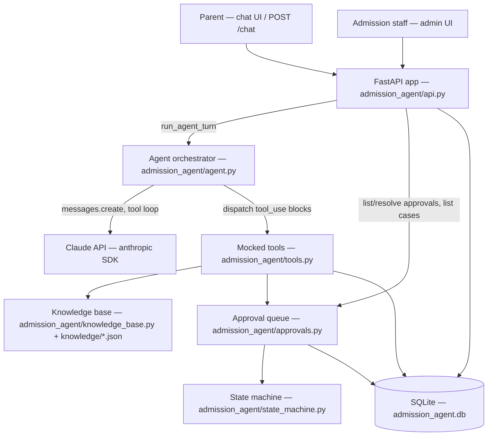
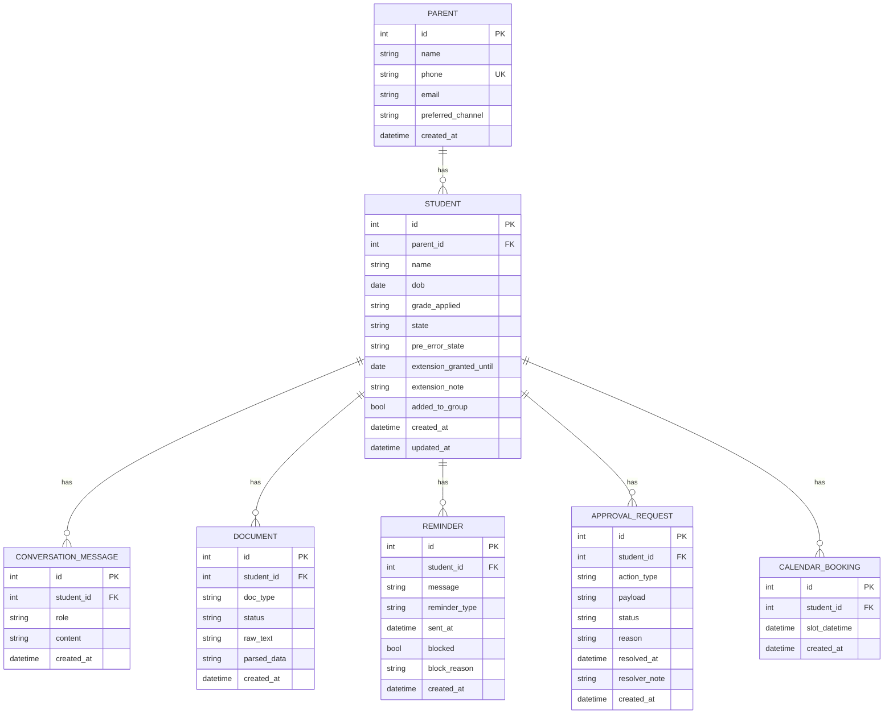
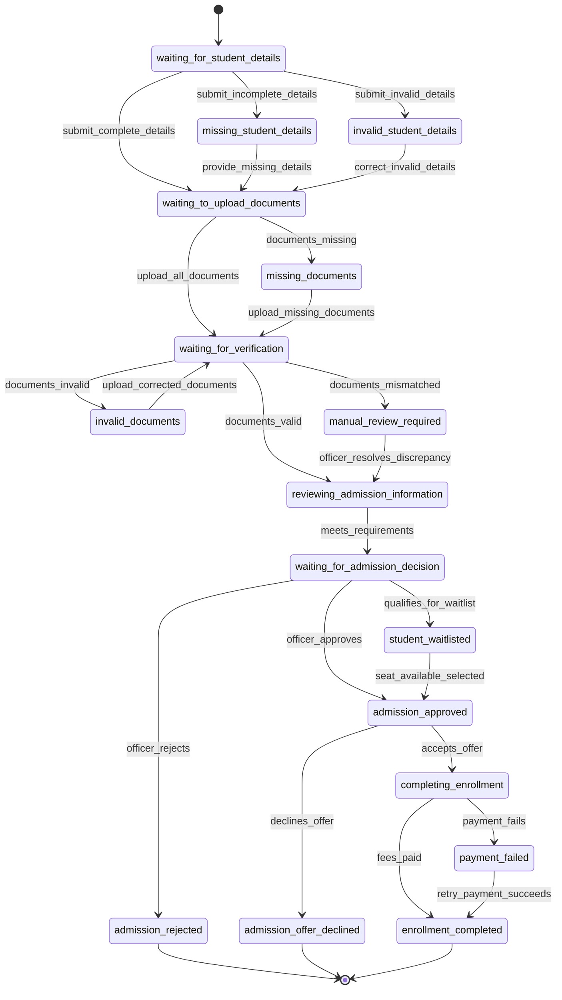
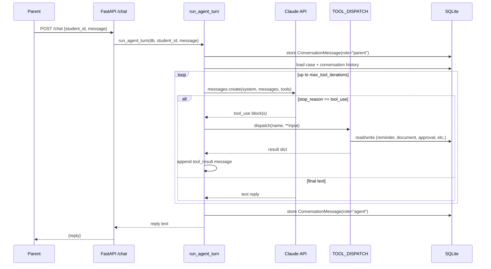

# Technical Architecture

This describes the actual code in the repository root as of commit `bdc32e7` on branch `implement-admission-agent` (post-review fix pass). Anything not yet built is explicitly marked **Proposed**.

## High-level component diagram

## Backend architecture

Single FastAPI app (`admission_agent/api.py`). No frontend build step — two Jinja2-rendered pages are served directly by the same app:

- `GET /` → `templates/chat.html` — a parent-facing chat page that POSTs to `/chat` via `fetch`.
- `GET /admin` → `templates/admin.html` — a staff-facing page that reads `/admin/approvals` and `/admin/cases`, and POSTs decisions to `/admin/approvals/{id}/decide`.

**Frontend:** plain HTML + vanilla JS (`<script>` blocks in the templates themselves). No JS framework, no build step. **Proposed/not built:** any mobile app, WhatsApp-native UI, or SPA — the spec's real channel (WhatsApp) is mocked, not integrated.

## Database structure and relationships

SQLAlchemy ORM over SQLite (`admission_agent/db.py`, `admission_agent/models.py`). Engine points at `sqlite:///admission_agent.db` (file-based) in the real app; tests use an in-memory SQLite DB per test via `tests/conftest.py`.

`Student.state` holds the string value of an `ApplicationState` enum member (see below) — it is a plain string column, not a DB-level enum/check constraint, so invalid values are only rejected by the application layer (`transition()`), never by the schema itself.

## Application state machine

`admission_agent/state_machine.py` implements the exact transition table from spec Layer 3 (table 3.3), as a pure function with no DB dependency:

Not shown above (applies from any non-terminal state): `withdraw_application` → `application_withdrawn`, `deadline_expired` → `application_deadline_expired`, `system_error` → `ai_system_error` (remembering the prior state), and `system_recovers` (only valid from `ai_system_error`) returns to that prior state. Any event issued from a terminal state (`admission_rejected`, `admission_offer_declined`, `enrollment_completed`, `application_withdrawn`, `application_deadline_expired`) raises `InvalidTransitionError`.

## API endpoints

| Method | Path | Purpose | Auth |
|---|---|---|---|
| GET | `/` | Parent chat page | None (page shell; no data) |
| POST | `/chat` | `{student_id, message, parent_phone}` → `{reply}`, runs the agent | `parent_phone` must match the parent on file for case data to appear in context — see Authentication below |
| GET | `/admin` | Staff admin page | None (page shell; no data — JS prompts for the token before calling the endpoints below) |
| GET | `/admin/approvals` | List pending `ApprovalRequest` rows (including `payload`, `resolved_by`) | Bearer `ADMIN_TOKEN` |
| POST | `/admin/approvals/{id}/decide` | `{decision, resolver_note?, resolved_by?}` → resolved approval, or 400/404/409 | Bearer `ADMIN_TOKEN` |
| GET | `/admin/cases` | List all students with state | Bearer `ADMIN_TOKEN` |

## Authentication and authorization

A code review caught that this was completely open in the original build; a stopgap now exists, but it is explicitly not a real auth system:

- **`/admin/approvals`, `/admin/cases`, `POST /admin/approvals/{id}/decide`:** gated behind a single shared bearer token (`require_admin` dependency in `api.py`, checked against the `ADMIN_TOKEN` environment variable). Any request without `Authorization: Bearer <ADMIN_TOKEN>` gets 401; if `ADMIN_TOKEN` isn't set at all, every admin request gets 503 rather than silently allowing access. There is no per-user login — every staff member who knows the token has full access, and `ApprovalRequest.resolved_by` is a free-text field the caller supplies, not a verified identity.
- **`GET /admin` (the page shell):** intentionally left ungated. A Bearer header can't be attached to a plain browser navigation, so gating the page itself would make it unreachable by normal navigation. The page has no data of its own — it prompts for the token via JS (`sessionStorage`) and attaches it to every real `fetch` call against the gated endpoints above.
- **`/chat`:** still has no bearer-token gate — it's meant for parents, not staff. Instead, the caller must supply `parent_phone`, and the agent only includes a student's case data (state, grade, parent contact) in the model's context when that phone matches the parent on file; otherwise it gets a context block explicitly instructing it to withhold case-specific details (see `run_agent_turn` in `agent.py`). This closes the confidentiality bypass the review found (case data was previously handed to the model unconditionally), but it is still just a phone-string match, not a real identity check — a leaked phone number is enough to pass it.

**Still not built:** a real login/session system for staff (tracked as Task 11 in `implementation-plan.md`), and any stronger parent-identity verification than a phone-number match.

## Agent / tool-calling data flow

If the loop exceeds `max_tool_iterations` without a final text response, `run_agent_turn` returns a fixed fallback ("I need to check with our admission staff and will get back to you") instead of looping forever or fabricating an answer — this is the spec's Layer 7.4 "stop if the answer cannot be verified" step.

## Important modules and their responsibilities

| Module | Responsibility |
|---|---|
| `admission_agent/db.py` | SQLAlchemy engine, session factory, `get_db()` FastAPI dependency |
| `admission_agent/models.py` | ORM models for all 7 entities |
| `admission_agent/state_machine.py` | Pure transition logic; no I/O |
| `admission_agent/knowledge_base.py` | Loads seeded JSON, keyword-overlap search |
| `admission_agent/approvals.py` | Create/list/resolve `ApprovalRequest`; the only code path that mutates admission-decision/fee-exception fields |
| `admission_agent/tools.py` | The 7 mocked tools + their Claude tool-use schemas (`TOOL_SCHEMAS`) and dispatch table (`TOOL_DISPATCH`) |
| `admission_agent/agent.py` | Builds the Claude message history, runs the tool-calling loop, persists conversation |
| `admission_agent/api.py` | FastAPI routes, request/response models, template rendering |

## Environment variables and configuration

| Variable | Used by | Required? |
|---|---|---|
| `ANTHROPIC_API_KEY` | `anthropic.Anthropic()` inside `run_agent_turn` when no `client` is injected | Required for real (non-test) chat traffic. Not required for the test suite — all tests inject a `FakeAnthropicClient`. |

`requirements.txt` lists `python-dotenv` as a dependency, but no code in the repository currently calls `load_dotenv()` — so a `.env` file is not actually read anywhere yet. **Proposed:** wire up `.env` loading if/when this runs outside a shell that already exports `ANTHROPIC_API_KEY`.

No `.env` file exists in this repository and none should ever be committed (see `.gitignore`, which excludes `.env` and `*.db`).

## Error handling, validation, logging, security

- **Validation:** request bodies are validated by Pydantic models (`ChatRequest`, `DecideRequest`) in `api.py`. `resolve_approval` raises `ValueError` for a `decision` outside `{"approved", "rejected"}`.
- **Error handling beyond that:** minimal. Lookups like `db.query(Student).filter_by(id=student_id).one()` raise SQLAlchemy's `NoResultFound` for an unknown ID, which FastAPI will currently turn into an unhandled 500 — there is no custom 404 handling. **Proposed:** add explicit not-found handling before any real deployment.
- **Logging:** none configured. All auditability currently comes from the DB rows themselves (`Reminder.blocked`/`block_reason`, `ApprovalRequest` history) rather than an application log.
- **Security:** government-ID-shaped digit runs are masked before storage (`tools.py::_mask_long_digits`); case data requires a phone match; high-risk state changes only happen through the approval queue. See `planning.md` → non-functional requirements for what is *not* covered (auth, rate limiting).
